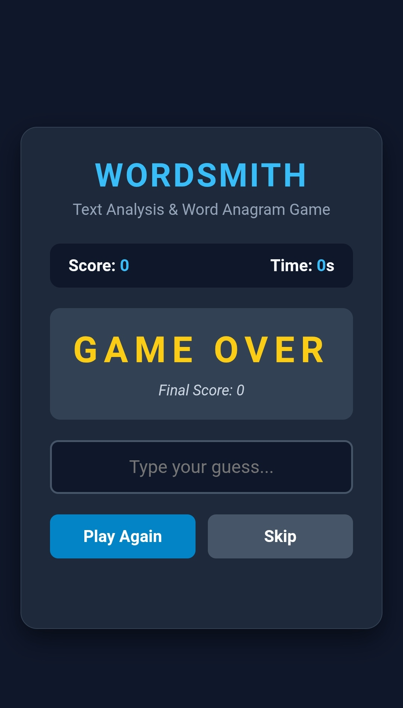
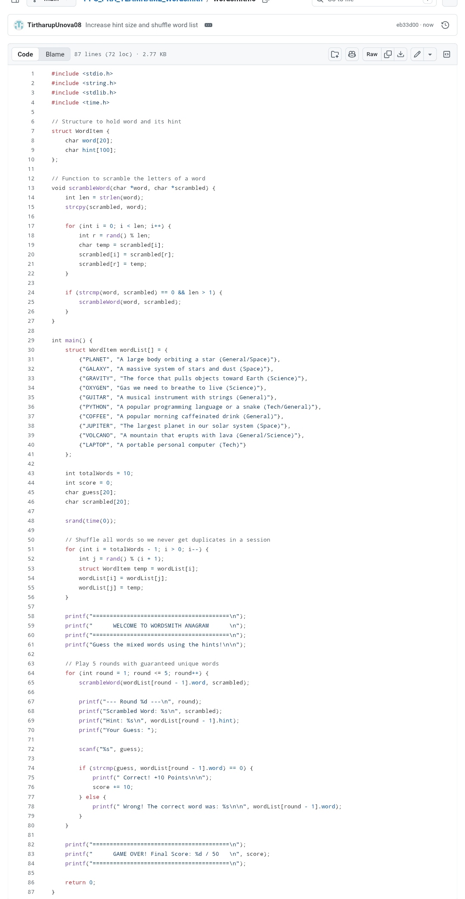
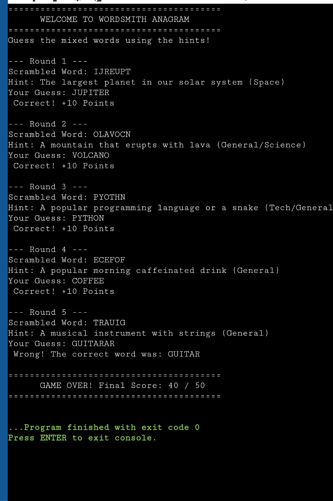

# Wordsmith: Terminal & Web Text Analysis Anagram Game

## 📌 Project Overview
**Wordsmith** is a creative cross-platform project built to test anagram-solving speed, string manipulation, and user interface design. It bridges low-level terminal logic with modern web architecture by featuring a C-based command-line program alongside a responsive web application prototype.

---

## 📝 Abstract
**WordSmith** is a console-based word anagram game written in C designed to test vocabulary and logical thinking through core programming concepts like strings, arrays, modular functions, and character frequency analysis. Beyond entertainment, it demonstrates how string-handling and text-analysis techniques apply to search engines, spell checkers, and natural language processing.

* **📄 Official Project Abstract Document:** [Download / View PRA_WordSmith.pdf](PRA_WordSmith.pdf)
* **Core Technologies & Concepts:** C Programming, String Manipulation, Algorithmic Shuffling (`rand()`), Text Analysis (Vowels/Consonants, Palindromes).
  

---

## 📊 Flowchart & Architecture
* **📄 Official Flowchart Document:** [Download / View WordSmith game flowchart.pdf](WordSmith game flowchart.pdf)

### Core Execution Pipeline:
1. **01 / Setup Phase:** Displays the main interactive menu, handles game mode selection (*Unscramble* or *Word builder*), generates target words, shuffles characters, and initializes the session timer[span_0](start_span)[span_0](end_span).
2. **02 / Gameplay Phase:** Manages real-time input validation, continuously checks remaining time and word accuracy, updates live scores dynamically, and loops rounds until completion[span_1](start_span)[span_1](end_span).
3. **03 / Results Phase:** Compiles final performance statistics, displays the aggregate score, and handles user prompts to restart or exit the application[span_2](start_span)[span_2](end_span).
4. 
---

## 🎨 Project Poster

## 🎥 YouTube Demo Video Link

---

## 📸 Project Visual Evidence & Screenshots

### 1. Web Game Interface (`index.html`)

* *Description:* Displays the live arcade container featuring responsive CSS styling, real-time timer countdowns, and dynamic hint rendering.

### 2. C Terminal Source Code (`wordsmith.c`)

* *Description:* Demonstrates the foundational C structure handling struct arrays, string manipulation functions, and secure memory tracking.

### 3. Terminal Execution Output

* *Description:* Captures a successful 5-round game session running in an online compiler environment, showing zero-warning compilation and clean score aggregation.
  

---

## 👥 Team & Submission Details
* **Project Type:** PPS PRA Activity (#5: GitHub Repository & Implementation)
* **Components Included:** C Terminal Source Code, HTML5 Web Prototype, Documentation, and Visual Proofs.
  
